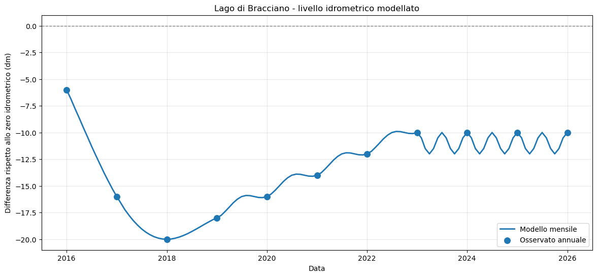
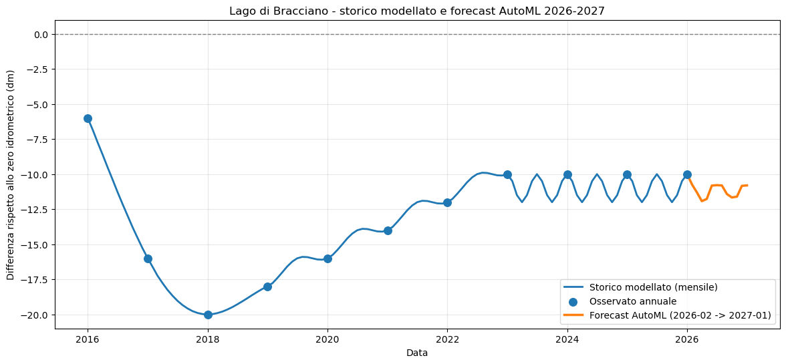

# Lago di Bracciano — dalla Maturità 2026 al mondo reale con Microsoft Fabric

> Un notebook che prende il problema di matematica della **seconda prova di Maturità 2026** e mostra come lo stesso tipo di analisi viene fatto nelle aziende, usando strumenti professionali di data analytics.

---

## Il problema: il Lago di Bracciano

Nella prova di Maturità 2026 (indirizzo scientifico) è stato proposto un problema sul **livello idrometrico del Lago di Bracciano** nel periodo 2016–2026.

Il livello del lago è descritto da una **funzione definita a tratti**:

- Un **polinomio di quarto grado** per il periodo 2016–2019 (fase di calo)
- Una **funzione lineare + oscillazione trigonometrica** per 2019–2023 (risalita)
- Una **funzione trigonometrica pura** per 2023–2026 (stabilizzazione con oscillazioni stagionali)

In pratica, il lago è sceso di molto fino al 2018 (ricordate la crisi idrica?), poi è risalito e si è stabilizzato intorno a -10 dm rispetto allo zero idrometrico.



---

## Perché la matematica conta (davvero)

Lo studio di funzioni, derivate, integrali e trigonometria che fate a scuola **non resta sulla carta**. Nel mondo reale:

- Le **funzioni a tratti** modellano fenomeni che cambiano comportamento nel tempo
- Le **serie trigonometriche** descrivono ciclicità (stagioni, maree, consumi energetici)
- L'**analisi dei dati storici** serve a prendere decisioni per il futuro

Le aziende che gestiscono risorse idriche, energia, trasporti usano *esattamente* questo tipo di matematica — su scala più grande e con strumenti più potenti.

---

## Come funziona nel mondo enterprise: Microsoft Fabric

In questo progetto ho preso il problema della Maturità e l'ho risolto con **Microsoft Fabric**, la piattaforma di data analytics di Microsoft. Ecco i pezzi che ho usato:

| Componente Fabric | A cosa serve |
|---|---|
| **Notebook (Spark/Python)** | Scrivere il codice, calcolare il modello, generare la serie storica mensile |
| **Lakehouse** | Salvare i dati in tabelle Delta Lake (come un database ottimizzato per analytics) |
| **AutoML (FLAML)** | Fare il forecast automatico: il computer sceglie da solo il miglior algoritmo di previsione |
| **Semantic Model (Direct Lake)** | Preparare i dati per Power BI senza doverli copiare |
| **Power BI** | Creare dashboard interattive per visualizzare e condividere i risultati |

### Il flusso è questo:

```
Dati del problema (maturità)
        ↓
Modello matematico (funzioni a tratti) → Serie mensile sintetica
        ↓
Lakehouse (salvataggio dati)
        ↓
AutoML (forecast 2027)
        ↓
Semantic Model + Power BI (visualizzazione)
```

---

## Il forecast: cosa succederà nel 2027?

Usando la serie storica generata dal modello matematico, ho fatto prevedere ad AutoML l'andamento dei 12 mesi successivi (febbraio 2026 → gennaio 2027).

Il sistema ha provato automaticamente diversi algoritmi (ARIMA, SARIMAX, LightGBM, XGBoost...) e ha scelto il migliore.



Il risultato mostra che il lago dovrebbe continuare a oscillare intorno ai -10/-11 dm — coerente con il modello trigonometrico dell'ultimo tratto.

---

## Come usare questo progetto all'orale

Se volete portare questo argomento al colloquio, ecco gli spunti:

1. **Matematica** → funzioni a tratti, derivate, punti di massimo/minimo, studio del segno
2. **Informatica** → programmazione in Python, librerie numeriche (NumPy, Pandas)
3. **Scienze** → ciclo idrologico, cambiamenti climatici, gestione delle risorse idriche
4. **Cittadinanza** → la crisi idrica del 2017 a Roma, politiche di gestione dell'acqua
5. **Inglese** → terminologia data science (forecast, time series, machine learning)

Il notebook dimostra che **lo stesso problema che risolvete su carta** viene affrontato nelle aziende con strumenti di AI e analytics, ma la base matematica è la stessa.

---

## Come eseguire il notebook

### Su Microsoft Fabric (consigliato)
1. Crea un workspace Fabric (anche con la [trial gratuita](https://www.microsoft.com/microsoft-fabric/getting-started))
2. Crea un Notebook e un Lakehouse
3. Copia il contenuto del file `.ipynb` nel notebook Fabric
4. Collega il Lakehouse e premi **Run All**

### In locale (solo la parte di calcolo)
```bash
pip install numpy pandas matplotlib flaml
jupyter notebook fabric_notebook_bracciano_report_forecast_2027_fixed.ipynb
```
> ⚠️ Le celle che usano `spark` e `sempy_labs` funzionano solo su Fabric.

---

## Struttura del progetto

```
├── fabric_notebook_bracciano_report_forecast_2027_fixed.ipynb   # Il notebook completo
├── images/
│   ├── modello_storico.png    # Grafico del modello 2016-2026
│   └── forecast_2027.png      # Grafico con forecast AutoML
└── README.md                  # Questo file
```

---

## Licenza

Progetto didattico — libero per uso scolastico e personale.

---

*Realizzato con GitHub Copilot + Microsoft Fabric per la Maturità 2026* 🎓
